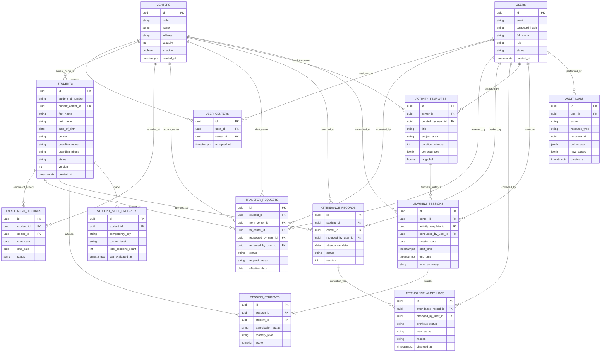

# EduTrack — Entity-Relationship (ER) Diagram

This document contains the visual data model for EduTrack, specifying all entities, attributes, primary keys (`PK`), foreign keys (`FK`), and relational cardinalities.

---

## 1. High-Level Entity Relationship Diagram

---

## 2. Cardinality & Relational Semantics

| Parent Entity | Child Entity | Cardinality | Semantics / Delete Rule |
| :--- | :--- | :--- | :--- |
| **`users`** | `user_centers` | $1 : N$ | Deleting a user cascades to remove center associations (`CASCADE`). |
| **`centers`** | `user_centers` | $1 : N$ | Deleting a center cascades to remove user assignments (`CASCADE`). |
| **`centers`** | `students` | $1 : N$ | Centers cannot be deleted if active students exist (`RESTRICT`). |
| **`students`** | `enrollment_records` | $1 : N$ | Preserves full chronological center migration history (`RESTRICT`). |
| **`centers`** | `enrollment_records` | $1 : N$ | Historical enrollments remain tied to center (`RESTRICT`). |
| **`students`** | `transfer_requests` | $1 : N$ | All transfer proposals are archived per student (`RESTRICT`). |
| **`students`** | `attendance_records` | $1 : N$ | Student cannot be purged if attendance history exists (`RESTRICT`). |
| **`attendance_records`** | `attendance_audit_logs` | $1 : N$ | If an attendance entry is removed, its corrections cascade (`CASCADE`). |
| **`activity_templates`** | `learning_sessions` | $1 : N$ | Templates with recorded sessions cannot be hard-deleted (`RESTRICT`). |
| **`learning_sessions`** | `session_students` | $1 : N$ | Deleting a session instance removes student participation entries (`CASCADE`). |
| **`students`** | `student_skill_progress`| $1 : N$ | Aggregated competency progress directly tied to student (`CASCADE`). |
| **`users`** | `audit_logs` | $1 : N$ | Actor references preserved or set to `NULL` on deletion (`SET NULL`). |

---

## 3. Structural Constraints Summary

1. **Many-to-Many Relationships Handled via Pure Junctions:**
   - Users $\longleftrightarrow$ Centers: Managed by `user_centers` with `UNIQUE (user_id, center_id)`.
   - Learning Sessions $\longleftrightarrow$ Students: Managed by `session_students` with `UNIQUE (session_id, student_id)`.
2. **Compound Uniqueness Constraints:**
   - Single Daily Attendance: `attendance_records (student_id, attendance_date) UNIQUE`.
   - Aggregated Skill Progress: `student_skill_progress (student_id, competency_key) UNIQUE`.
   - Unique Center Codes: `centers (code) UNIQUE`.
   - Unique User Identities: `users (email) UNIQUE`.
   - Unique Student Registration: `students (student_id_number) UNIQUE`.
